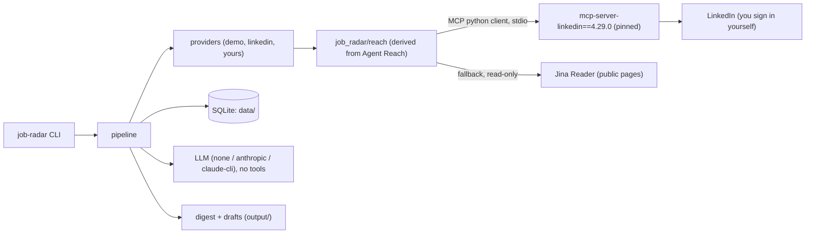
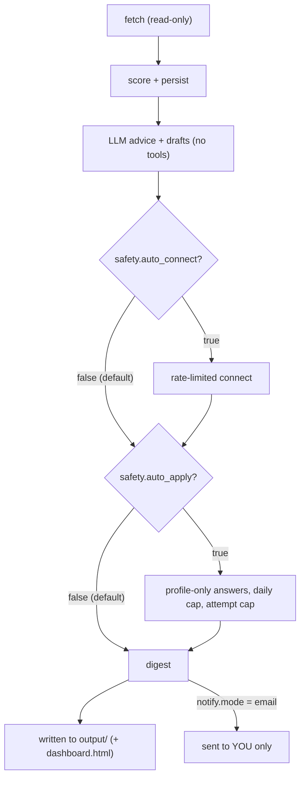

# Job Radar Agent

Self-hosted job-search agent: finds jobs, scores them against **your** profile, drafts applications and keeps
you in control. **Dry-run by default. Nothing is sent, applied or connected until you switch it on.**

One install, one config, one CLI, one state store, one log. Works for any role, country and tech stack.
Linux, macOS and Windows.

> **Disclaimer:** automating LinkedIn may violate its Terms of Service and can get your account restricted.
> You are responsible for your own use. Start with dry-run and low limits. Read [DISCLAIMER.md](DISCLAIMER.md).

## Documentation

[Getting started](docs/getting-started.md) · [Configuration & profile](docs/configuration.md) · [Adding sources](docs/adding-sources.md) · [LinkedIn setup](docs/linkedin-setup.md) · [Safety model](docs/safety.md) · [Troubleshooting](docs/troubleshooting.md) · [Licensing notes](docs/licensing.md)

## Quick start

```bash
pipx install "job-radar-agent[linkedin]"      # or: pip install -e ".[dev]" from a clone
mkdir my-job-search && cd my-job-search
job-radar init                                # questions -> config.json, profile.md, .env, then `doctor`
job-radar run --dry-run                       # open output/digest.html
```

Try it with no account at all: the default source is `demo` (synthetic jobs).

To use LinkedIn: add `"linkedin"` to `sources.enabled`, run `job-radar login` and sign in yourself in the
browser window (the tool never sees your password), then `job-radar doctor`.

## Features

- Pipeline: search -> score -> optional LLM advice -> cover-letter **drafts** -> connect -> Easy Apply (experimental, opt-in) -> digest.
- Generic scoring (titles, skills with weights, years, locations, work mode, exclusions, thresholds) from config.
- Persistent SQLite state with a permanent attempt limit: the same job is never applied to twice.
- `profile.md` is the only source of truth for application answers; unknown answers skip the job and are
  flagged in the digest (`job-radar answer "question" "answer"`).
- `doctor` checks Python, config, profile, paths, email, LLM, git ignore rules and the LinkedIn MCP server,
  and prints how to fix each problem.
- Automatic backend fallback: MCP -> read-only Jina Reader for public pages, with the backend logged.
- Shared retries, timeouts, random delays, rate limits and a circuit breaker.
- Provider interface for new sources (see [CONTRIBUTING.md](CONTRIBUTING.md)).
- Coach: **suggests** config changes, can never change safety settings, never commits.
- Eval suite with synthetic cases: `job-radar eval`.
- **Dashboard** (`output/dashboard.html`): best jobs, application tracker, recruiters, what needs your answer. A static local file.
- **Application tracker**: from your own applications, `job-radar track`, and (opt-in) read-only mailbox reading of job alerts and status emails.
- **Recruiter discovery** (opt-in): read-only LinkedIn people search, stored locally with automatic expiry.
- **Email digest to yourself** when you set `notify.email_to` and credentials in `.env`.

## Architecture





Reading and acting are separate: LLM steps read untrusted text and only write drafts/advice. Every action is
decided by plain code from config, profile and the store.

## Safety defaults

| Setting | Default |
|---|---|
| `safety.dry_run` | `true` (a CLI flag can never turn it off) |
| `safety.auto_apply` / `auto_connect` / `send_emails` | `false` |
| `safety.max_applications_per_day` / `max_connects_per_day` | 3 / 5 |
| `safety.max_attempts_per_job` | 2 |
| `safety.min_delay_seconds` / `max_delay_seconds` | 5 / 20 random delay between actions |
| Answers to questions | only from `profile.md`; missing -> skip job and flag it |
| Emails/messages to employers | never sent; drafts only. The digest goes only to your own `notify.email_to` |
| Mailbox reading / recruiter search | off; read-only, authenticated senders only, no LLM, nothing stored but basics |
| Coach | suggestions only; refuses `safety.*`; writes config without committing |
| Dependencies | all pinned (`mcp-server-linkedin==4.29.0`, `mcp==2.3.0`, ...), no `@latest` |

## Configuration reference

`config.json` (see `config.example.json`; unknown keys are errors):

| Key | Meaning |
|---|---|
| `search.titles` / `keywords` | what to look for |
| `search.excluded_keywords` / `excluded_companies` | hard excludes (score 0) |
| `search.locations` | `[{"name": "Berlin, Germany"}]` |
| `search.work_modes` | `remote`, `hybrid`, `onsite` |
| `search.posted_within_days`, `max_pages` | date range and depth |
| `search.seniority.min_years` / `max_years` | experience range you accept |
| `scoring.title_match`, `skills{}`, `years_fit`, `years_over_penalty`, `location_match`, `remote_bonus` | weights |
| `scoring.thresholds` | `best`, `stretch`, `apply_min` |
| `schedule.times` | used by `job-radar schedule ...` |
| `language` | language of outputs |
| `sources.enabled` | `demo`, `linkedin`, or your own provider |
| `sources.linkedin.backend_order` | `["mcp", "jina"]` |
| `llm.provider` | `none`, `anthropic`, `claude-cli`; `llm.max_calls_per_run` |
| `notify.mode` | `none` or `email` (digest to yourself, also in dry-run); credentials only in `.env` |
| `mailbox.*` | opt-in read-only IMAP: `enabled`, `senders`, `max_days`, `require_auth` |
| `search.recruiters.*` | opt-in recruiter search: `enabled`, `keywords`, `locations`, `max_per_run`, `keep_days` |
| `paths.*` | data, output and sessions folders (inside the project) |

`.env` (placeholders in `.env.example`): `JOB_RADAR_SMTP_USER`, `JOB_RADAR_SMTP_PASSWORD`, `ANTHROPIC_API_KEY`.
`profile.md` (see `profile.example.md`, a fake candidate) holds your facts, skills with years and saved answers.
Templates (cover letter, outreach, digest, prompts) can be overridden by copying them into `./templates/`.

## Make it yours

- **Your profile and filters:** `job-radar init`, then edit `profile.md` and `config.json` (any role, country, stack).
- **Your own job source:** `job-radar new-provider myboard` creates `plugins/myboard.py`; or use the built-in `rss` source for any feed.
- **Your wording:** `job-radar templates` copies the cover-letter, outreach, digest and prompt templates into `./templates/`.
- **Before you share your folder or fork:** `job-radar privacy-check --term "your name"`.

## Commands

`init` · `doctor` · `run [--dry-run]` · `digest [--send]` · `coach [--apply ID]` · `eval` · `status` ·
`answer "question" "answer"` · `login [--status] [--apply-browser]` · `reset-session` · `schedule cron|systemd|windows` ·
`providers` · `new-provider NAME` · `templates` · `privacy-check [--term WORD]` · `dashboard` · `applications` ·
`track COMPANY TITLE [--status S]` · `people [list|purge --all]`

## Run on a schedule

`job-radar schedule cron`, `... systemd`, or `... windows` prints snippets with your paths and times.
Templates are in [scheduling/](scheduling/). Docker: `docker compose up` runs the agent and the pinned
LinkedIn MCP server in one container (sign in once on your machine and keep `./sessions`).

## Sessions

LinkedIn sessions live only in the git-ignored `sessions/` folder. Reset: `job-radar reset-session`, then
`job-radar login`. No password or cookie is ever stored in config or env.

## Credits and licenses

- [Agent Reach](https://github.com/Panniantong/Agent-Reach) (MIT, Copyright (c) 2025 Agent Eyes): parts of
  `src/job_radar/reach/` are derived from v1.5.0, commit `f65526cbaaad3879473acc1ba6dbefd195caf2be`.
- [linkedin-mcp-server](https://github.com/stickerdaniel/linkedin-mcp-server) (Apache-2.0, Daniel Sticker):
  installed as a pinned dependency, not vendored.
- See [NOTICE](NOTICE) and [THIRD_PARTY_LICENSES](THIRD_PARTY_LICENSES). This project is MIT licensed
  ([LICENSE](LICENSE)). "Job Radar Agent" is the name of this project; forks should use another name.

## FAQ

**Will my account be banned?** It can be. See the disclaimer; use dry-run, low limits, a secondary account.
**Does it email employers?** No. It writes drafts. **Where is my data?** `data/`, `output/`, `sessions/`
on your machine, all git-ignored. **Why no Node/mcporter?** The official Python MCP client talks to the server directly.

## Contributing, security, license

[CONTRIBUTING](CONTRIBUTING.md) (DCO sign-off, how to add a provider) · [SECURITY](SECURITY.md) ·
[CODE_OF_CONDUCT](CODE_OF_CONDUCT.md) · [CHANGELOG](CHANGELOG.md).
Licensed under the [MIT License](LICENSE). Third-party notices: [NOTICE](NOTICE), [THIRD_PARTY_LICENSES](THIRD_PARTY_LICENSES).
Trademark note: the license covers the code, not the project name. Please rename your fork.
